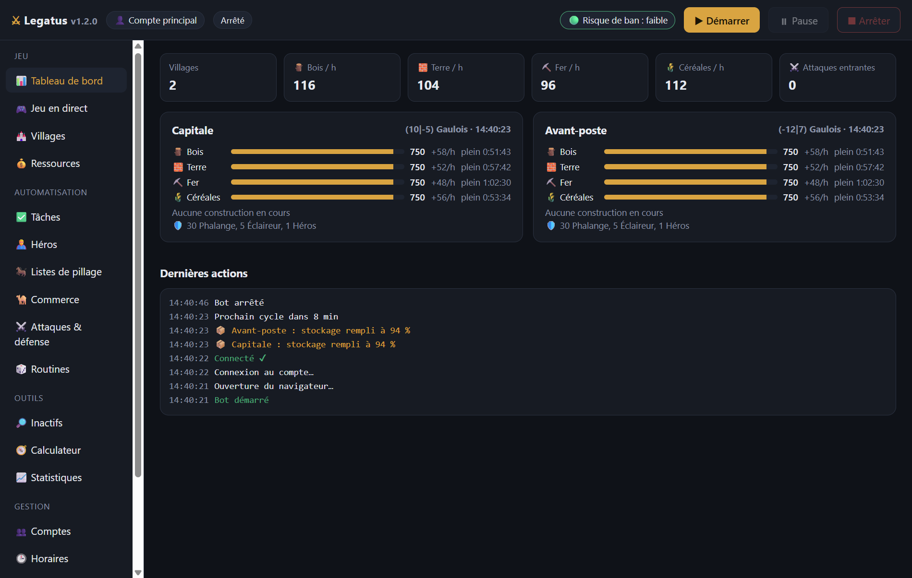

# ⚔ Legatus

**Ton assistant pour Travian: Legends sur Windows.** Legatus gère tes villages pendant que tu fais autre chose : constructions, troupes, pillages, héros, commerce… le tout depuis une seule fenêtre, en français.

## 📥 Télécharger

**[➡️ Télécharger la dernière version](../../releases/latest)** (fichier `Legatus Setup x.y.z.exe`)

Une licence est nécessaire pour utiliser le bot : voir [Obtenir une licence](#-obtenir-une-licence).

## ✨ Fonctions

| | |
|---|---|
| 🏗️ **Constructions** | File d'attente par village, champs automatiques, planificateur (économique, militaire, équilibré, expansion), modèles réutilisables |
| ⚔️ **Troupes** | Formation en boucle, forge, envois planifiés à la seconde, évacuation avant une attaque |
| 🐎 **Pillages** | Listes de pillage du jeu, intervalles aléatoires, désactivation des cibles qui coûtent des pertes, recherche d'inactifs |
| 🦸 **Héros** | Aventures, répartition des points, oasis avec estimation des pertes, ressources du héros, récompenses |
| 🐪 **Commerce** | Routes automatiques entre tes villages |
| 📊 **Suivi** | Tableau de bord, prévisions de stock, statistiques, alertes Windows, Discord et Telegram |
| 👥 **Multi-comptes** | Plusieurs comptes, chacun avec ses réglages |
| 🕒 **Horaires** | Heures d'activité par jour pour jouer comme un humain |
| 🛡️ **Risque de ban** | Un badge te prévient dès qu'un réglage augmente le risque |
| 🎮 **Jeu en direct** | Le navigateur du bot affiché dans l'appli : tu peux reprendre la main à tout moment |

## 💻 Installation

1. Télécharge `Legatus Setup x.y.z.exe` depuis la [page des versions](../../releases/latest).
2. Lance-le. Si Windows affiche **« Windows a protégé votre ordinateur »** : clique sur **Informations complémentaires**, puis **Exécuter quand même**.
3. Accepte le contrat d'utilisation et laisse-toi guider. Un raccourci **Legatus** est créé sur le Bureau.

**Il te faut :** Windows 10 ou 11 (64 bits) et Microsoft Edge (déjà présent sur Windows) ou Google Chrome.

## 🔑 Obtenir une licence

1. Rejoins le serveur Discord : <!-- DISCORD -->*lien bientôt disponible*<!-- /DISCORD -->
2. Ouvre Legatus, onglet **🔑 Licence**, et clique sur **Copier** à côté de *Identifiant de ce PC*.
3. Envoie cet identifiant sur le Discord pour demander ta clé (tarifs et formules sur le Discord).
4. Colle la clé reçue dans l'onglet **🔑 Licence**, puis clique sur **Activer**.

La clé est liée à ton PC. Tu changes d'ordinateur ? Demande une nouvelle clé sur le Discord.

## 🚀 Premiers pas

1. Onglet **Compte** : l'adresse de ton serveur (ex. `https://ts1.x1.europe.travian.com`), ton pseudo et ton mot de passe.
2. Choisis ce que le bot doit faire dans chaque onglet (constructions, troupes, héros…).
3. Clique sur **▶ Démarrer**.

## 🔒 Tes données

Ton mot de passe reste sur ton PC, chiffré par Windows. Legatus ne l'envoie qu'au serveur du jeu. Les alertes Discord ou Telegram ne partent que si tu les configures.

## 🔄 Mises à jour

Télécharge la nouvelle version et installe-la par-dessus l'ancienne : tes comptes, réglages et ta licence sont conservés.

## ⚠️ Avertissement

Les règles de Travian interdisent les programmes d'automatisation : **utiliser Legatus peut entraîner le bannissement de ton compte**. Tu l'utilises sous ta seule responsabilité. Legatus est un outil indépendant, sans lien avec Travian Games GmbH ; « Travian » est une marque de son propriétaire.

Voir le [contrat d'utilisation](LICENCE.txt).
